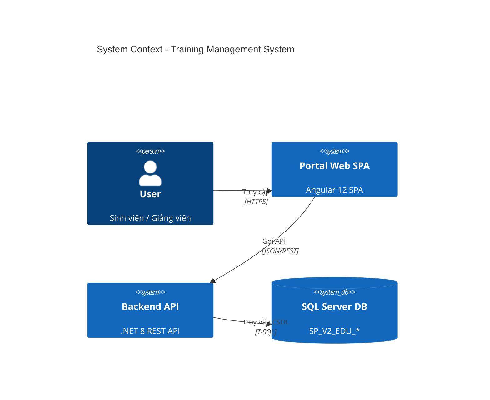

# SKILL: architecture-diagram-generator (v3.0 - Powered by Archify Core)

**PURPOSE**: Tạo sơ đồ kiến trúc hệ thống trực quan, tương tác cao dưới dạng file HTML độc lập chứa inline SVG, dark/light themes, route probing, dependency tracing và xuất ảnh đa định dạng (PNG/JPEG/WebP/SVG/WebM). Sử dụng bộ biên dịch Archify v3.0 (Zero runtime dependencies, chạy native Node.js).

**Trigger**: Tải skill này khi một pipeline stage cần trực quan hóa kiến trúc hệ thống — sau thiết kế Blueprint, sau phân tích tác động hệ thống Analyze, hoặc sau khi lập giải pháp ADRs trong Solution.

**Load**: `await skill({ name: "architecture-diagram-generator" })`

---

## 1. OUTPUT CONTRACT

```
Output HTML:     workflow/{KEY}/diagrams/{name}.html
Output Sidecars: workflow/{KEY}/diagrams/.sidecars/ (tự động giấu các file .candidate.json, .finalize.json, .delivery.json)
Format:          Single self-contained HTML file (nhúng CSS, inline SVG, runtime viewer tương tác)
```

Mỗi file HTML sinh ra:
- Là file `.html` độc lập, đầy đủ styling và script tương tác (không cần kết nối internet hay máy chủ ngoài trừ font Google Fonts).
- Hỗ trợ đầy đủ phím tắt tương tác: `R` (Route probe), `L` (Role lens), `F` (Fullscreen), `T` (Theme dark/light), `E` (Export PNG/SVG).
- Tuân thủ palette chuẩn: Dark theme `#020617` (slate-950), font `JetBrains Mono`.
- Ghi nhận marker kết thúc: `[DIGRAM_GENERATED] | Type: {type} | HTML: {path}.html`

---

## 2. NHANH: QUY TRÌNH BIÊN DỊCH JSON IR (FAST AUTHORING PATH)

Thay vì tính toán tọa độ pixel hay vẽ thẻ `<svg>` thủ công (dễ lỗi đè nhãn/lệch lưới), AI **chỉ cần tạo file JSON IR có cấu trúc**, sau đó gọi bộ biên dịch Archify tự động giải bài toán layout, routing và đóng gói HTML:

### Bước 1: Chọn loại sơ đồ (Diagram Type Router)

| Type | Mục đích | Schema | Mẫu tham khảo |
|---|---|---|---|
| `architecture` | Thành phần, dịch vụ, CSDL, ranh giới mạng/bảo mật, vùng triển khai | `schemas/architecture.schema.json` | `examples/web-app.architecture.json` |
| `workflow` | Quy trình công việc, luồng CI/CD, chuỗi phê duyệt, tool calls, runbooks | `schemas/workflow.schema.json` | `examples/agent-tool-call.workflow.json` |
| `sequence` | Chuỗi gọi API, vòng đời request, async trace, fallback cache miss | `schemas/sequence.schema.json` | `examples/cache-miss-request.sequence.json` |
| `dataflow` | Pipeline ETL/ELT, dòng chảy dữ liệu, phân loại nhạy cảm | `schemas/dataflow.schema.json` | `examples/product-analytics.dataflow.json` |
| `lifecycle` | Máy trạng thái (State machine), chuyển đổi trạng thái, retry, kết thúc | `schemas/lifecycle.schema.json` | `examples/agent-run.lifecycle.json` |

### Bước 2: Tạo Candidate JSON IR

Tạo file tạm `candidate.json` (ghi file bằng UTF-8 No BOM):

```json
{
  "schema_version": 1,
  "diagram_type": "architecture",
  "meta": {
    "title": "Tên hệ thống / System Title",
    "subtitle": "Mô tả ngắn gọn / Subtitle",
    "output": "{output-filename}.html",
    "quality_profile": "showcase"
  },
  "components": [
    { "id": "fe", "type": "frontend", "label": "Web Portal", "sublabel": "Angular 12", "pos": [50, 250], "size": [140, 60] },
    { "id": "be", "type": "backend", "label": "API Service", "sublabel": ".NET 8 Web API", "pos": [330, 250], "size": [150, 60], "tag": "MethodResult" },
    { "id": "db", "type": "database", "label": "SQL Server", "sublabel": "Enterprise MSSQL", "pos": [610, 250], "size": [140, 60], "tag": "SP_V2_EDU_*" }
  ],
  "boundaries": [
    { "kind": "region", "label": "Application Tier", "wraps": ["be"] },
    { "kind": "security-group", "label": "Database Tier", "wraps": ["db"] }
  ],
  "connections": [
    { "id": "fe-to-be", "from": "fe", "to": "be", "label": "HTTPS REST / JSON", "variant": "emphasis" },
    { "id": "be-to-db", "from": "be", "to": "db", "label": "Execute SP", "variant": "security" }
  ],
  "cards": [
    { "dot": "cyan", "title": "Frontend", "items": ["Angular 12 Nx workspace", "Kendo UI Grid"] },
    { "dot": "emerald", "title": "Backend", "items": [".NET 8 Clean Architecture", "MediatR CQRS"] },
    { "dot": "violet", "title": "Database", "items": ["SQL Server Stored Procedures"] }
  ]
}
```

### Bước 3: Chạy Lệnh Finalize Nguyên Tử

Chạy lệnh CLI qua `bin/archify.mjs`:

```bash
node skills/architecture-diagram-generator/bin/archify.mjs finalize <type> <candidate.json> <output.html> --quality showcase --json
```

- **Thành công (`ok: true`)**: Sinh file HTML hoàn chỉnh, passing toàn bộ các cổng (`validate`, `deliver`, `check`, `browser-check`).
- **Thất bại (`ok: false`)**: Đọc trường `diagnostics[].supportedFixes` trong JSON stdout để sửa lại `candidate.json` (tối đa 2 lần lặp). Không đoán mò.

### Bước 4: Tự động gom sạch Sidecars vào `.sidecars/`
Sau khi finalize sinh ra file HTML, lập tức di chuyển toàn bộ các file metadata JSON (`*.candidate.json`, `*.finalize.json`, `*.finalize-summary.json`, `*.delivery.json`, `*.browser-check.json`) vào thư mục con `diagrams/.sidecars/`.
Giữ thư mục `diagrams/` tuyệt đối sạch sẽ, người dùng mở ra chỉ thấy các file `.html` trực quan.

---

## 3. ARCHITECTURE DELTA (SO SÁNH DIFF KIẾN TRÚC)

Sử dụng lệnh `compare` để so sánh trực quan hai bản kiến trúc (`base` trước thay đổi và `head` sau thay đổi, ví dụ trong `/solution`):

```bash
node skills/architecture-diagram-generator/bin/archify.mjs compare architecture <base.json> <head.json> <delta.html> --json
```

Kết quả sinh ra file `delta.html` trực quan hóa:
- **Added**: Màu xanh lá (thành phần/kết nối mới thêm).
- **Modified**: Màu vàng (thành phần có thay đổi cấu hình/nhãn/phạm vi).
- **Removed**: Màu đỏ nét đứt (thành phần bị gỡ bỏ).
- **Unchanged**: Màu xám mờ.

---

## 4. BILINGUAL POLICY (QUY CHUẨN ĐA NGÔN NGỮ)

Văn bản hiển thị trên sơ đồ ưu tiên **tiếng Việt trước, tiếng Anh bổ trợ sau** để đảm bảo tính rõ ràng:
- Tiêu đề: `Hệ thống Quản lý Đào tạo / Training Management System`
- Nhãn thành phần: `Cổng thanh toán / Payment Gateway — Stripe API`
- Giữ nguyên các định danh kỹ thuật, tên file, API route, command, database table name, stored procedure (`SP_V2_EDU_*`).

---

## 5. DESIGN SYSTEM & COLOR ROLES

| Role / Type | Mã màu chuẩn | Ý nghĩa sử dụng |
|---|---|---|
| `frontend` | `#22d3ee` (cyan-400) | Ứng dụng client, UI, SPA, edge devices |
| `backend` | `#34d399` (emerald-400) | Web API, Microservices, Background workers |
| `database` | `#a78bfa` (violet-400) | CSDL quan hệ (SQL Server), Cache (Redis), Data lakes |
| `cloud` | `#fbbf24` (amber-400) | Hạ tầng Cloud, Load balancer, S3 storage, CDN |
| `security` | `#fb7185` (rose-400) | Auth Provider, Firewall, Security groups |
| `messagebus`| `#fb923c` (orange-400)| Queue (RabbitMQ/SQS), Event bus (Kafka) |
| `external` | `#94a3b8` (slate-400) | Hệ thống bên thứ 3, người dùng ngoài |

---

## 6. C4 MERMAID SNIPPET FALLBACK (DÀNH CHO TÀI LIỆU MARKDOWN)

Khi cần nhúng sơ đồ văn bản nhanh vào các báo cáo markdown (`.md` ADRs), sử dụng Mermaid C4:



---

## 7. TÀI LIỆU THAM CHIẾU SÂU (references/)

8 doc đã nằm trong `references/` — đọc theo nhu cầu (không đọc mặc định):

| File | Khi nào đọc |
|---|---|
| `authoring-contract.md` | Hợp đồng field/enum/output-path; sửa lỗi geometry đo được; node icons |
| `authoring-defaults.md` | Chọn abstraction + preset/palette TRƯỚC khi đặt tọa độ |
| `delivery-contract.md` | Gate thất bại + repair; standalone command; provenance/recovery; export; sequence-width-review |
| `architecture-layout-repair.md` | Nhiều connector Architecture rối |
| `repository-authoring.md` | Gắn `meta.repository` + `sources[]` (git-pinned evidence) |
| `viewer-runtime.md` | Khi user hỏi capability reader-facing (Guide/Lens/Route Probe/Share Card…) |
| `brand-marks.md` | Gắn `brand` cho node (brand lạ → `archify brands capture`) |
| `update-awareness.md` | Khi receipt báo `update.noticeRequired` |

## 8. MERMAID INPUT (parse → JSON-IR)

Nhận Mermaid dán vào và chuyển sang IR (giữ nghĩa, không giữ style Mermaid):
- `flowchart` / `graph` → `workflow` (hoặc `architecture` nếu là component map).
- `sequenceDiagram` → `sequence` (participant → participant, mũi tên → message).
- `stateDiagram` → `lifecycle` (state/transition giữ nghĩa).

## 9. CANDIDATE HANDOFF & DOCTOR

- Có JSON sẵn → đi thẳng nhánh handoff, không tạo lại từ đầu.
- Kiểm tra môi trường: `node bin/archify.mjs doctor`. Drift upstream: `skill-release.json`.
