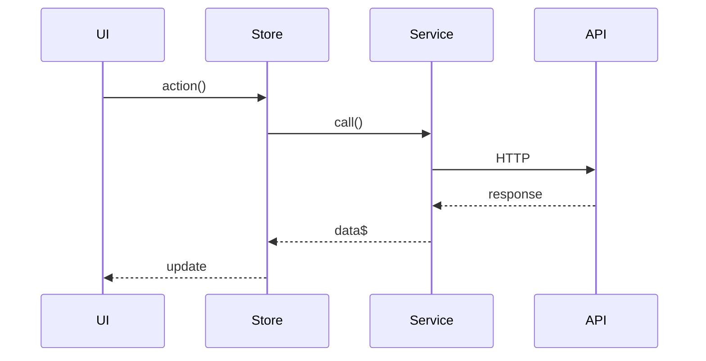

## 4. FE Technical Design Template

```markdown
---
key: "{KEY}"
type: FE_TECHNICAL_DESIGN
risk_score: {riskScore}
risk_level: {riskLevel}
estimated_hours: {estHours}
jira_sync:
  field: customfield_11003
  auto_update: true
quality_gates:
  section_d_complete: ${(feData.components?.length ?? 0) > 0}
  section_e_complete: ${(feData.services?.length ?? 0) > 0}
  sequence_generated: ${(feData.components?.length ?? 0) > 0 || (feData.services?.length ?? 0) > 0}
  checklist_all_pass: ${(feData.components?.length ?? 0) > 0 && (feData.services?.length ?? 0) > 0}
approved: false
---

# FE TECHNICAL DESIGN: {KEY}
Parent: {parent} | Project: {project} | Date: {date}
Risk: {riskLevel} | Score: {riskScore} | Est.Hours: {estHours}

## 0. Scope Summary
**Muc tieu:** {summary}
**Modules affected:** {nxModules}

| Metric | Count |
|:-------|:-----:|
| Components (NEW) | {N} |
| Components (MODIFY) | {M} |
| Services (NEW) | {K} |
| Form fields | {P} |
| i18n keys | {Q} |

## A. Tenant & Gating
**Logic tenant:** {tenantLogic}
**Gating type:** {gateType}

## B. Current State (Files Found)
| File Path | Module | Type | Purpose | Legacy? |
|:----------|:-------|:----:|:--------|:-------:|

## C. Repos & Branch
| Repo | Branch | Base |
|:-----|:-------|:-----|

## D. View / UI Changes
### Component Tree
```
{Module}/
+-- {Feature}.component.ts
    +-- {ChildGrid}.component.ts
    +-- {ChildForm}.component.ts
+-- {Feature}Service.ts
```

### Form Field Mapping
| Field | Control Type | Source | Validation | i18n Key |
|:------|:-------------|:-------|:-----------|:---------|

### Route Config
```typescript
{ path: '{route}', component: {FeatureComponent}, data: { permission: '{Module}_{Action}' } }
```

## E. JS / Kendo / Components Logic
### Services
| Service | Method | API Endpoint | Return Type |
|:--------|:-------|:-------------|:------------|

### State Management
```typescript
interface {Feature}State { items: Dto[]; loading: boolean; }
readonly items$ = this.select(s => s.items);
```

### Sequence Diagram


**Mermaid syntax rule**: `sequenceDiagram` only supports `participant X as Y` or `actor X as Y` for explicit actor declarations — never `component`, `class`, or other keywords from other diagram types. If you don't need an alias, skip the declaration entirely and mermaid auto-creates participants from the first arrow they appear in (as in the example above).

## F. Language Resources
| Key | English | Vietnamese | Component |
|:----|:--------|:-----------|:----------|

## G. Impact Analysis
| Affected Component | Impact | Risk | Shared? |
|:-------------------|:-------|:----:|:-------:|

## H. Task Breakdown
| # | Task | Files | AC | SP | Depends |
|:-:|:-----|:------|:---|:--:|:-------:|

## I. Constraints for Coder
- {constraint}: {reason}

## J. Questions to Resolve
| # | Question | Assignee | Severity | Status |
|:-:|:---------|:---------|:---------:|:------|

## K. Review Checklist
| # | Item | Source | Auto-Pass? | Status |
|:-:|:-----|:-------|:----------:|:------|
| 1 | UI components mapped | Section D | ✅ | Auto |
| 2 | API integration defined | Section E | ✅ | Auto |
| 3 | i18n keys listed | Section F | ✅ | Auto |
| 4 | Permissions checked | Section A | ⚠️ | Pending |
| 5 | Sequence diagram generated | Section E | ✅ | Auto |
| 6 | All tasks have AC | Section H | ✅ | Auto |
```

---

## 5. Template Generation Functions

### Fill template placeholders

```javascript
function fillTemplate(template, data) {
  let result = template;
  for (const [key, value] of Object.entries(data)) {
    const placeholder = new RegExp(`\\{${key}\\}`, 'g');
    result = result.replace(placeholder, String(value ?? ''));
  }
  return result;
}
```

### generateBETemplate

```javascript
function generateBETemplate(KEY, beData, date, project) {
  const riskScore = calcRiskScore(
    beData.spNew || 0, beData.spModify || 0,
    beData.tableAlter || 0, beData.newApi || 0,
    beData.legacySp || 0
  );
  const riskLvl = riskLevel(riskScore);
  const estHours = estimateHours('BE', beData);

  const template = `---
key: "${KEY}"
type: BE_TECHNICAL_DESIGN
risk_score: ${riskScore}
risk_level: ${riskLvl}
estimated_hours: ${estHours}
jira_sync:
  field: customfield_11002
  auto_update: true
quality_gates:
  section_d_complete: ${(beData.queries?.length ?? 0) > 0}
  section_e_complete: ${(beData.controllers?.length ?? 0) > 0}
  sequence_generated: ${(beData.controllers?.length ?? 0) > 0 || (beData.queries?.length ?? 0) > 0}
  checklist_all_pass: ${(beData.queries?.length ?? 0) > 0 && (beData.controllers?.length ?? 0) > 0}
approved: false
---

# BE TECHNICAL DESIGN: ${KEY}
Date: ${date}
Risk: ${riskLvl} | Score: ${riskScore}

## 0. Scope Summary
**Modules affected:** ${(beData.controllers?.[0]?.file || "").split("/")[0] || "TBD"}

## B. Current State (Files Found)
| File Path | Type |
|:----------|:----:|
${(beData.controllers || []).slice(0, 10).map(f => `| \`${f.file}\` | Controller |`).join("\n")}
${(beData.services || []).slice(0, 10).map(f => `| \`${f.file}\` | Service |`).join("\n")}

## D. Database Changes
| SP Name | Action |
|:--------|:------:|
${(beData.queries || []).slice(0, 10).map(f => `| \`${f.file}\` | MODIFY |`).join("\n")}

## E. Service / Controller
| Endpoint | Method |
|:---------|:------:|
${(beData.controllers || []).slice(0, 10).map(f => `| \`${f.file}\` | TBD |`).join("\n")}

## H. Error Handling
| HTTP | Condition | Response | Action |
|:----:|:----------|:---------|:-------|
| 200 | Success | `MethodResult<T>` | Standard success |
| 400 | Validation error (invalid params) | `VoidMethodResult` with message | Log warning, return field errors |
| 404 | Resource not found | `VoidMethodResult` | Log info |
| 500 | Internal server error | `VoidMethodResult` | Log error, notify operations |

**Error handling pattern:** Global middleware filter (`ExceptionFilter` or `Middleware`). Validation errors from FluentValidation auto-mapped to 400. Business rule violations return 400 with domain message. Unhandled exceptions → 500 with generic message (no stack trace exposed).

**Logging:** Always attach correlation ID. Log validation errors as Warning. Log 500s as Error with full stack trace (internal only).

## K. Review Checklist
| # | Item | Status |
|:-:|:-----|:------:|
| 1 | Section D: DB changes defined | ${(beData.queries?.length ?? 0) > 0 ? "✅" : "⚠️"} |
| 2 | Section E: Endpoints defined | ${(beData.controllers?.length ?? 0) > 0 ? "✅" : "⚠️"} |
| 3 | Sequence diagram generated | ${(beData.controllers?.length ?? 0) > 0 || (beData.queries?.length ?? 0) > 0 ? "✅" : "⚠️"} |
| 4 | Error handling defined | ✅ |
| 5 | No blocking dependencies | ⚠️ |
`;
  return template;
}
```

### generateFETemplate

```javascript
function generateFETemplate(KEY, feData, date, project) {
  const riskScore = calcRiskScore(
    feData.components?.length || 0, 0,
    0, feData.services?.length || 0, 0
  );
  const riskLvl = riskLevel(riskScore);
  const estHours = estimateHours('FE', feData);

  const template = `---
key: "${KEY}"
type: FE_TECHNICAL_DESIGN
risk_score: ${riskScore}
risk_level: ${riskLvl}
estimated_hours: ${estHours}
jira_sync:
  field: customfield_11003
  auto_update: true
quality_gates:
  section_d_complete: ${(feData.components?.length ?? 0) > 0}
  section_e_complete: ${(feData.services?.length ?? 0) > 0}
  sequence_generated: ${(feData.components?.length ?? 0) > 0 || (feData.services?.length ?? 0) > 0}
  checklist_all_pass: ${(feData.components?.length ?? 0) > 0 && (feData.services?.length ?? 0) > 0}
approved: false
---

# FE TECHNICAL DESIGN: ${KEY}
Date: ${date}
Risk: ${riskLvl} | Score: ${riskScore}

## 0. Scope Summary
**Modules affected:** ${(feData.components?.[0]?.file || "").split("/")[0] || "TBD"}

## B. Current State (Files Found)
| File Path | Type |
|:----------|:----:|
${(feData.components || []).slice(0, 10).map(f => `| \`${f.file}\` | Component |`).join("\n")}
${(feData.services || []).slice(0, 10).map(f => `| \`${f.file}\` | Service |`).join("\n")}

## D. View / UI Changes
| Component | File |
|:----------|:----:|
${(feData.components || []).slice(0, 10).map(f => `| \`${f.file.split("/").pop().replace(".ts", "")}\` | \`${f.file}\` |`).join("\n")}

## H. Error Handling
| HTTP | Condition | Response | Action |
|:----:|:----------|:---------|:-------|
| 400 | Validation error | Snackbar/Toast with message | Log warning |
| 404 | Not found | Error state component | Log info |
| 500 | Server error | Generic error page | Log error |

**Error handling pattern:** All API calls use `ApiService` base class which auto-handles errors. Show toast/snackbar for user-facing errors. Log to console.error for debugging. Business validation errors map to form field errors (pattern: `errorStts`).

**Error state management:** Each data grid/list component should handle loading, error, and empty states. Use `catchError` in pipe to set error flag, `finalize` to reset loading flag.

## K. Review Checklist
| # | Item | Status |
|:-:|:-----|:------:|
| 1 | UI components mapped | ${(feData.components?.length ?? 0) > 0 ? "✅" : "⚠️"} |
| 2 | API integration defined | ${(feData.services?.length ?? 0) > 0 ? "✅" : "⚠️"} |
| 3 | Error handling defined | ✅ |
| 4 | Sequence diagram generated | ${(feData.components?.length ?? 0) > 0 || (feData.services?.length ?? 0) > 0 ? "✅" : "⚠️"} |
`;
  return template;
}
```

### writeBlueprint (orchestrator)

```javascript
async function writeBlueprint(CONFIG_ROOT, KEY, scope, beData, feData, bpMode) {
  const date = new Date().toISOString().split('T')[0];
  let beDoc = null;
  let feDoc = null;
  const outputs = [];

  const bePath = (scope === 'BOTH' || scope === 'BE')
    ? `${CONFIG_ROOT}/workflow/reports/blueprint/${KEY}-BE-technical-design.md` : 'N/A';
  const fePath = (scope === 'BOTH' || scope === 'FE')
    ? `${CONFIG_ROOT}/workflow/reports/blueprint/${KEY}-FE-technical-design.md` : 'N/A';

  // Single canonical contract — same line embedded in every generated doc and returned to the caller
  const contract = `[BLUEPRINT_DONE] | Key: ${KEY} | BE: ${bePath} | FE: ${fePath} | Mode: ${bpMode}`;
  const handoffFooter = ['', '---', contract, `Date: ${date} | Next: /decompose ${KEY}`].join('\n');

  if (scope === 'BOTH' || scope === 'BE') {
    beDoc = generateBETemplate(KEY, beData, date) + handoffFooter;
    await write(bePath, beDoc);
    outputs.push({ role: 'BE', path: bePath, size: beDoc.length });
  }

  if (scope === 'BOTH' || scope === 'FE') {
    feDoc = generateFETemplate(KEY, feData, date) + handoffFooter;
    await write(fePath, feDoc);
    outputs.push({ role: 'FE', path: fePath, size: feDoc.length });
  }

  return { beDesign: beDoc, feDesign: feDoc, outputs, contract };
}
```

---

## 6. Usage

```javascript
await skill({ name: "blueprint-writer" });
// Then:
// 1. Collect scan data (use codebase-scanner)
// 2. Call writeBlueprint(CONFIG_ROOT, KEY, scope, beData, feData)
```

---

## 7. Output Language Rules

The technical design reports must use **English** for all structural and technical content.

### Allowed in Vietnamese
| Context | Example |
|:--------|:--------|
| i18n key *values* (not keys) | `value: "Số giờ dự kiến là bắt buộc"` |
| BA-provided business terms with no English equivalent | `"Đơn vị chủ trì"` (explain: "hosting unit") |
| Jira description quotes | When citing user story verbatim |
| Field labels in i18n tables | For display on UI (but provide English translation column) |

### Must be English
| Context | Example |
|:--------|:--------|
| Section headers | `## D. Database Changes` (NOT `## D. Thay đổi CSDL`) |
| Table headers | `| Endpoint | Method | Description |` |
| Field descriptions | `trangThaiCongViec — employment status filter` |
| Validation messages | `soGioDuKien is required and must be > 0` |
| Acceptance Criteria | `User can search by name` |
| Code comments | `// Default: 'DangLamViec' mapped to send NULL` |
| i18n keys | `LB.SO_GIO_DU_KIEN_REQUIRED` (keys always English) |
| Risk descriptions | `LOW`, `MEDIUM`, `HIGH` (not THẤP/CAO) |
| Sequence diagram labels | `UI->>API: POST /SearchNhanSuPopup` |

### MANDATORY — All generated .md output must be English-first.
If BA input is in Vietnamese, translate technical terms to English. Keep original BA text only in quoted references.

---

## 8. CONTRACT

```
[BLUEPRINT_DONE] | Key: {KEY} | BE: {path|N/A} | FE: {path|N/A} | Mode: {FULL|PARTIAL|UPDATE}
```

This is the single canonical contract line for the blueprint stage — emitted once by `writeBlueprint()`, embedded identically in both the BE and FE output docs, and echoed as the command's final output line. No other format should be used.

